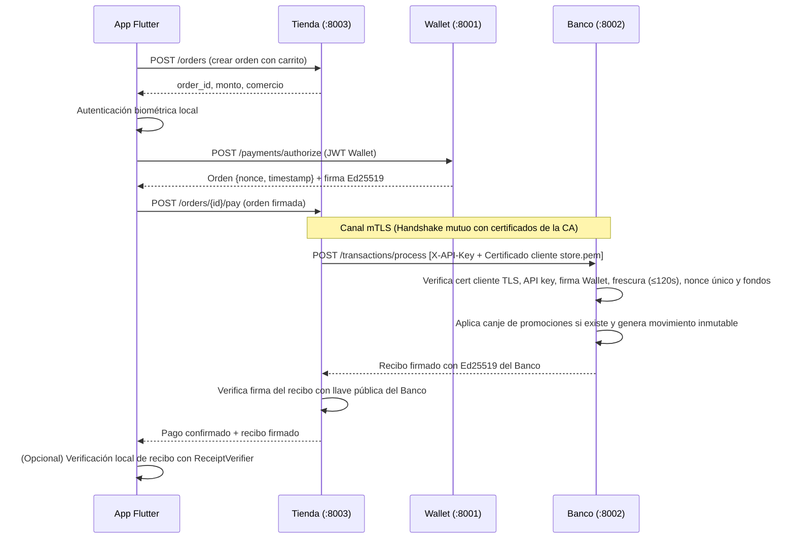
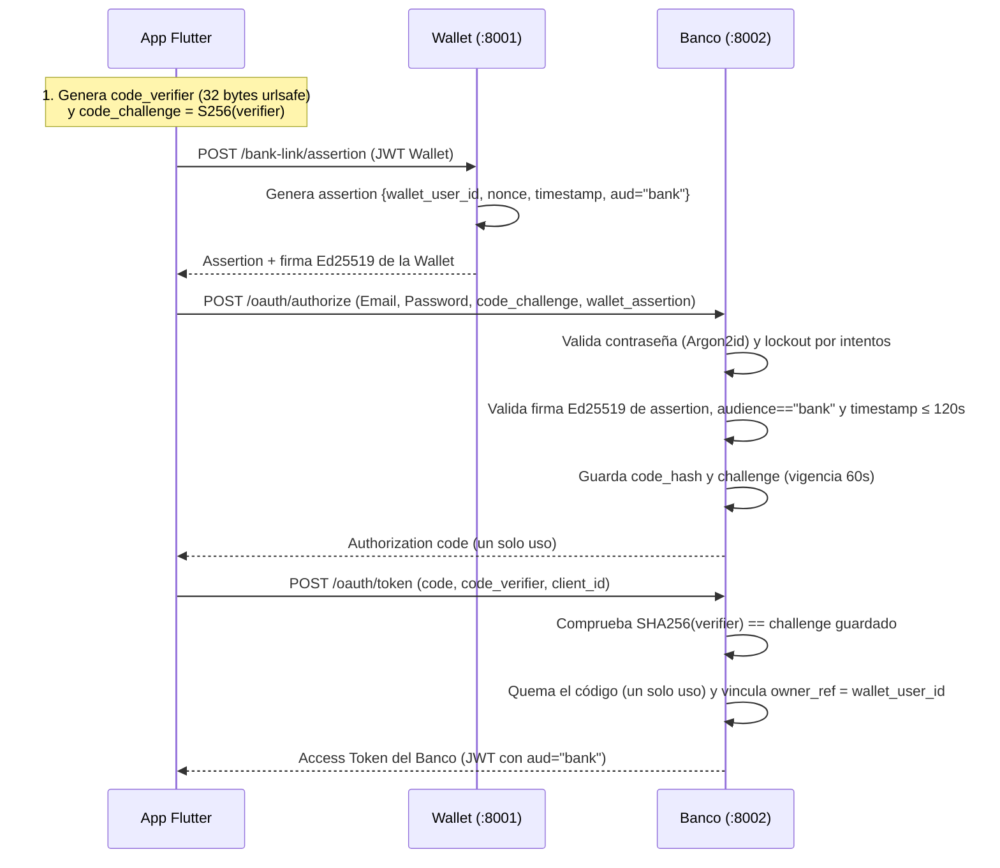
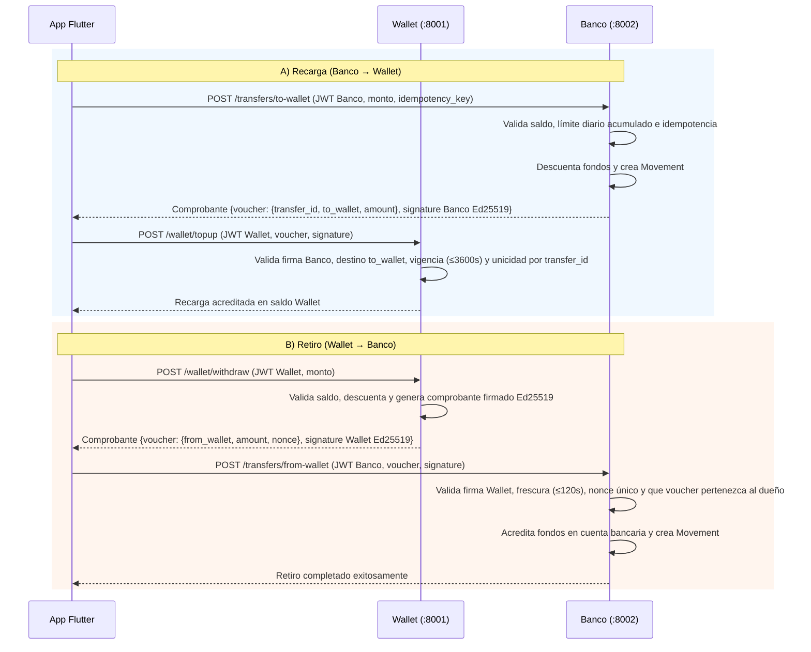

# Arquitectura

## Componentes

| Componente | Tecnología | Puerto | Responsabilidad |
|---|---|---|---|
| App móvil | Flutter | — | UI unificada de Wallet, Banco y Tienda |
| Wallet Service | FastAPI + SQLAlchemy | 8001 | Usuarios, sesiones, tarjetas cifradas, firma de órdenes y aserciones |
| Bank Service (simulado) | FastAPI | 8002 | Promociones, cuentas, validación de pagos, transferencias y recibos firmados |
| Store Service (simulada) | FastAPI | 8003 | Catálogo, órdenes, cobro vía Banco con cliente mTLS |
| Base de datos | SQLite (dev) / PostgreSQL (docker) | 5432 | Una base de datos independiente por servicio |

---

## Llaves y secretos

| Secreto / Certificado | Dónde vive | Para qué |
|---|---|---|
| `JWT_SECRET` | Wallet (:8001) | Firmar y verificar tokens de sesión de la Wallet |
| `BANK_JWT_SECRET` | Banco (:8002) | Firmar y verificar tokens de clientes del Banco (`aud="bank"`, scopes: `accounts:read`, `promotions:read`, `promotions:redeem`, `transfers:write`, `admin`). Distinto de `JWT_SECRET`. |
| `DATA_ENCRYPTION_KEY` | Wallet | Cifrar números de tarjeta (PAN) en reposo mediante AES-256-GCM (32 bytes en base64url) |
| Par Ed25519 **Wallet** | Privada: Wallet · Pública: Banco | La Wallet firma órdenes de pago (`/payments/authorize`), comprobantes de retiro y aserciones de vinculación |
| Par Ed25519 **Banco** | Privada: Banco · Pública: Tienda y App | El Banco firma recibos de compra aprobados y comprobantes de recarga (`to_wallet`) |
| `BANK_API_KEY` | Banco y Tienda | Cabecera `X-API-Key` para autenticación de servicio a servicio |
| CA interna (`ca.pem`, `ca.key`) | Entorno / Certs | Autoridad Certificadora raíz (`CN=SecureWallet Root CA`) que firma los certificados mTLS |
| Certificado Banco (`bank.pem`, `bank.key`) | Banco (:8002) | Certificado TLS de servidor con extensiones SAN (`DNS:localhost`, `DNS:bank`, `IP:127.0.0.1`) |
| Certificado Tienda (`store.pem`, `store.key`) | Tienda (:8003) | Certificado de cliente (`CN=store`, EKU `clientAuth`) exigido por el Banco en el canal mTLS |

---

## Diagramas de secuencia y flujos de seguridad

### 1. Flujo de pago y cobro con mTLS (B7)

---

### 2. Vinculación de Cuenta Bancaria (OAuth2 + PKCE + Aserción Wallet) (B2)

---

### 3. Transferencias Banco ↔ Wallet (B5)

---

## Controles de seguridad por capa

- **Identidad y Acceso:**
  - Contraseñas protegidas con **Argon2id**.
  - Bloqueo de cuenta tras 5 intentos fallidos durante 15 minutos (`lockout_minutes`).
  - Tokens JWT separados con audiencias estrictas (`aud="wallet"` vs `aud="bank"`).
  - Autorización en Banco basada en scopes y comprobación del rol `admin` directamente en la base de datos (anti-elevación de privilegios).
  - Vinculación Wallet ↔ Banco con **OAuth2 Authorization Code + PKCE S256** (RFC 7636) y aserciones firmadas por la Wallet.
- **Datos en reposo:**
  - Cifrado simétrico autenticado **AES-256-GCM** para PAN de tarjetas, con datos autenticados asociados (AAD) vinculados al usuario.
  - Tokenización de tarjetas sin almacenamiento de códigos CVV.
- **Integridad y no repudio:**
  - Firmas digitales **Ed25519** sobre representaciones canónicas JSON (RFC 8785) para órdenes de pago, recibos de compra y comprobantes de transferencias.
  - Bitácora inmutable en movimientos y transferencias; hash encadenado en la Wallet.
- **Protección Anti-Replay e Idempotencia:**
  - Parámetros `nonce` aleatorios criptográficos y ventanas de frescura de 120 segundos.
  - Claves de idempotencia (`idempotency_key`) y restricciones de unicidad (`UNIQUE`) en bases de datos para pagos, canjes de promociones y transferencias.
- **Seguridad en transporte y canal entre servicios:**
  - **mTLS obligatorio** entre Tienda y Banco: el servidor Banco exige certificado de cliente (`--ssl-cert-reqs 2`) firmado por la CA del proyecto y la Tienda valida el certificado del Banco con la CA.
  - Cabecera `X-API-Key` como defensa en profundidad.
- **Seguridad en la App móvil:**
  - Claves y tokens de sesión gestionados de forma segura.
  - Confirmación biométrica (`LocalAuthentication`) para acciones sensibles: canje de promociones, autorización de pagos y transferencias.
