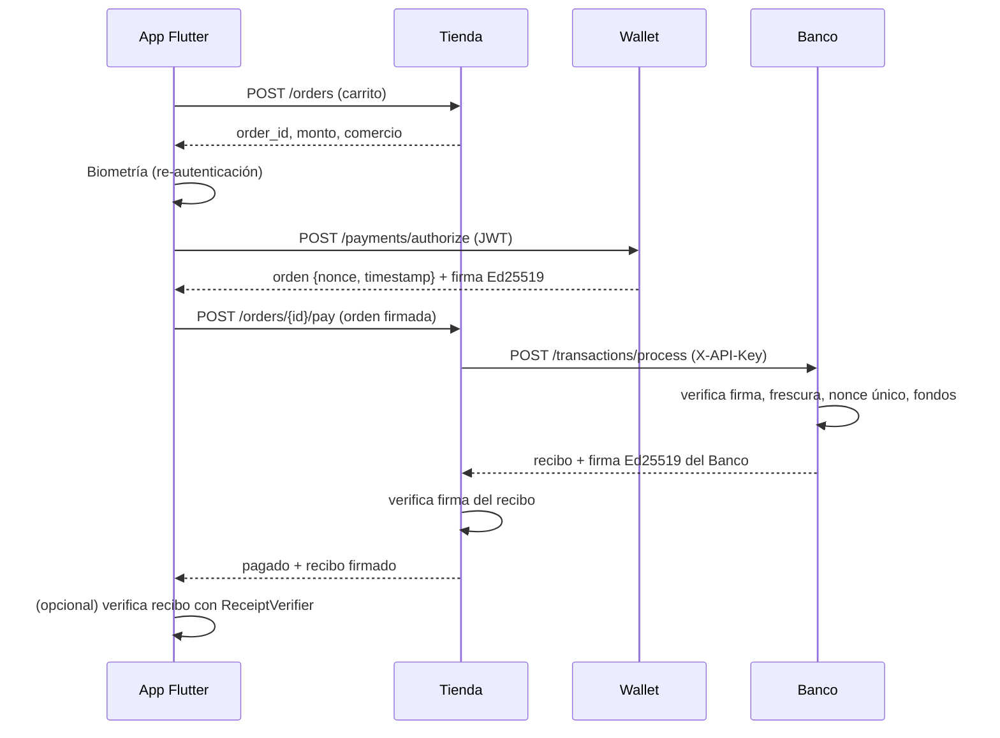

# Arquitectura

## Componentes

| Componente | Tecnología | Puerto | Responsabilidad |
|---|---|---|---|
| App móvil | Flutter | — | UI de Wallet, Banco y Tienda |
| Wallet Service | FastAPI + SQLAlchemy | 8001 | Usuarios, sesiones, tarjetas, firma de órdenes de pago |
| Bank Service (simulado) | FastAPI | 8002 | Promociones, cuentas, validación de pagos, recibos firmados |
| Store Service (simulada) | FastAPI | 8003 | Catálogo, órdenes, cobro vía Wallet/Banco |
| Base de datos | SQLite (dev) / PostgreSQL (docker) | 5432 | Una BD por servicio |

## Llaves y secretos

| Secreto | Dónde vive | Para qué |
|---|---|---|
| `JWT_SECRET` | Wallet | Firmar sesiones |
| `DATA_ENCRYPTION_KEY` | Wallet | Cifrar PAN (AES-256-GCM) |
| Par Ed25519 **Wallet** | Privada: Wallet · Pública: Banco | La Wallet firma órdenes de pago |
| Par Ed25519 **Banco** | Privada: Banco · Pública: Tienda y App | El Banco firma recibos |
| `BANK_API_KEY` | Banco y Tienda | Autenticación servicio a servicio (mejorar con mTLS) |

## Flujo de pago

## Controles de seguridad por capa

- **Identidad:** Argon2id, bloqueo por intentos, JWT corto, (pendiente) TOTP 2FA.
- **Datos en reposo:** AES-256-GCM con AAD = id de usuario; tokenización de tarjetas.
- **Integridad y no repudio:** firmas Ed25519 sobre JSON canónico; bitácora con hash encadenado.
- **Anti-replay:** `nonce` único + `timestamp` con ventana de 120 s + UNIQUE en BD.
- **Transporte:** (pendiente) TLS 1.3, certificate pinning, mTLS entre servicios.
- **App:** token en Keystore/Keychain; biometría para operaciones sensibles.
